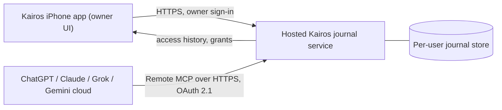

# Kairos on iPhone: TestFlight V1 plan

> **Status: PROPOSAL. Nothing in this document describes a shipped iPhone app or hosted service. This is a plan.**
> Dated Oct 10, 2026. Official sources were checked on Oct 10, 2026.

Claim labels used below: **[in repo, file:line]** is read from this checkout at commit `f632a7c` (before this doc). **[official doc, URL]** is from a page checked Oct 10, 2026. **[proposed]** is a design idea, not a fact. **[unverified]** means the page did not load or does not say.

## 1. What exists today vs. what is proposed

| Exists in this repo (observed) | Proposed for the iOS and hosted product (not built) |
| --- | --- |
| A local Node MCP server [in repo, `src/server.ts`, `package.json` v0.1.0, `"private": true`] | An iPhone app (SwiftUI, TestFlight) as the owner's control panel |
| stdio transport [in repo, `src/server.ts:24,115`] and a local-only Streamable HTTP mode at `POST /mcp` with one shared bearer (authentication) token [in repo, `src/http.ts:40,64-83`] | A hosted remote MCP endpoint reachable by cloud AI, with per-provider OAuth 2.1 sign-in |
| One SQLite file via `better-sqlite3` [in repo, `src/journal.ts:23`] | A hosted per-user store (design open) |
| 8 tools: `journal_wake`, `journal_write`, `journal_search`, `journal_verify`, `journal_export`, `journal_pin`, `journal_unpin`, `journal_about` [in repo, `src/tools.ts:99,135,185,210,229,254,273,291`] | Same tools plus a topic-continuation tool (below) |
| Hash-chained, append-only entries; edits and deletes are refused by database triggers [in repo, `src/journal.ts:178-183`] | "Hide" behaviour for V1 (proposed); true erasure is an open decision (section 8) |
| `journal_wake` returns pinned plus recent entries [in repo, `src/journal.ts:474`]; `journal_search` is keyword search [in repo, `src/journal.ts:432`, FTS table at `:165`] | `journal_continue(project)`: exact-tag lookup, newest first, size-capped, says so when nothing matches [proposed] |
| README lists limits: no OAuth, no encryption beyond disk encryption, no sync [in repo, `README.md:240-244`] | OAuth, accounts, sync, per-provider permissions and revocation, encryption design [proposed] |

**Absent from the repo (verified by `git ls-files`):** any iOS or iPhone code, Xcode project or Swift; any hosted service; OAuth or accounts; sync; per-provider permissions, revocation or access history; encryption at rest; a `journal_continue` tool or any `project-` tag handling; anything verified to run on iOS (the SQLite binding is a Node native add-on). Tests exist (`test/`) but were not run for this document.

## 2. The iPhone-only user's successful demo (end state) [proposed]

Maya has only an iPhone. She installs the TestFlight build, creates a journal, and connects one AI. She tells it about her kitchen remodel. Later, in a different AI, she says "pick up my kitchen remodel" and gets the kitchen notes, not notes from her other projects. In the Kairos app she sees which AI read what and when, turns one off, and that AI is refused on its next call. No Mac, no Git, no terminal.

## 3. Simplest proposed architecture [proposed]

- **iPhone app does:** create the journal; view entries; correct or hide; export; see each provider's access and last-read time; turn a provider off; delete the account and all data.
- **Hosted service does:** stores the journal; acts as (or integrates with) an OAuth 2.1 authorization server; exposes the remote MCP endpoint; records which provider read or wrote what.
- **The iPhone itself cannot be the server the AI providers reach.** Evidence: Claude states remote connectors are called from Anthropic's cloud, not the device, in every client including mobile [official doc, Claude Help, checked Oct 10 2026]; Grok says a custom MCP server must be reachable over the public internet [official doc, xAI]; ChatGPT connects to remote servers and not directly to local ones [official doc, OpenAI]. iOS suspends apps shortly after they leave the foreground, so a phone-hosted server would not stay reachable [official doc, Apple, partly verified; see section 9]. No official page found says an iPhone app can act as an MCP server for other AI apps [unverified absence].

## 4. Free shared journal as the default [proposed]

- One journal per person, shared by default across every connected provider, free to use.
- This document makes no pricing or monetization claims. Any usage limits (entries, size, request rate) are **to be decided** and none are promised.
- Each provider's own plan requirements are separate (section 9) and outside Kairos's control.

## 5. Provider permissions and revocation, in plain language [proposed]

For each of ChatGPT, Claude, Grok and Gemini, the app would show: connected or not; what it may do (read, write); when it last read or wrote; and a switch to turn it off. A separate "delete everything" removes the account and journal.

How turning one off would work:
1. **At Kairos:** revoke that provider's OAuth grant and invalidate its access and refresh credentials. The next call from that provider gets an HTTP 401 [official doc: MCP authorization says invalid or expired credentials must receive 401].
2. **At the provider:** the user should also remove or disconnect the connector in that provider's settings. Claude lets users revoke by disconnecting the connector [official doc, Claude Help]; Gemini lets users disconnect, unlink, or remove a custom app [official doc, Google].
3. **What revoking does not do:** it does not erase text a provider already received and may keep in a conversation or its own records. Kairos can stop future reads; it cannot recall past ones. Copy in the app must say this.

## 6. Three-minute demo script (iPhone only) [proposed]

| Time | Step | Notes |
| --- | --- | --- |
| 0:00-0:45 | Install the TestFlight build; create a journal | TestFlight install via invitation or public link [official doc, Apple] |
| 0:45-1:45 | Connect one provider | See conditions below. The connector may need to be added once on the provider's web client |
| 1:45-2:30 | Tell AI A about a project; in AI B ask to pick it up and get that project's notes | Needs two connected providers, or two fresh chats in one provider as a fallback |
| 2:30-3:00 | Open the app; see what each provider read; turn one off; show its next call is refused | |

Provider conditions (what the docs say, not a promise):
- **ChatGPT:** custom MCP apps are web only, "No - web only" for mobile; full MCP (including writes) is rolling out in beta for Business, Enterprise and Edu; Pro can connect with read/fetch only in developer mode; Free and Plus are not mentioned (unknown) [official doc, OpenAI]. So ChatGPT is **not** a reliable phone-only demo path.
- **Claude:** custom connectors are available on Free (one connector), Pro, Max, Team and Enterprise; calls originate from Anthropic's cloud, including from the mobile apps [official doc, Claude Help]. Whether a connector can be added from the iPhone app is not stated on that page [unverified]. Fallback: add once on claude.ai in a browser, then use it from the phone app [unverified].
- **Gemini:** custom apps need age 18+, US, English, a personal Google account, and Keep Activity on; they can only be added in the Gemini web app, then used in the mobile app [official doc, Google]. A server without Dynamic Client Registration needs credentials entered manually.
- **Grok:** custom MCP connectors are added at grok.com/connectors; the server must be on the public internet [official doc, xAI]. Plan limits, supported auth modes and mobile behaviour are not stated [unverified].

## 7. Measurable TestFlight acceptance criteria

All numbers are **proposed targets, to be confirmed**, not results.

1. Install-to-first-saved-memory median under 3 minutes across at least 10 testers.
2. Connect success at least 80% over at least 20 attempts per provider that the docs support; failures are logged with a reason.
3. Correct-project recall in at least 9 of 10 fresh-context runs, with zero entries from another project in any run.
4. When nothing matches, the response says so explicitly in 10 of 10 runs; no invented context.
5. Revocation: after turning a provider off, its next call fails with an authorization error within 60 seconds in 10 of 10 trials.
6. Hide: a hidden entry is absent from continue, search and wake results in 10 of 10 trials; the app states plainly whether hidden text is retained.
7. Account deletion exists in the app, and a deleted account's data is no longer retrievable by any provider (verified by test).
8. The app shows, per provider, the last access time and what category of data was read.
9. No internal names, codenames or non-product terms appear in any user-visible string (checked by a string audit of the build).
10. Privacy policy link present in-app and in App Store Connect; App Privacy answers completed and consistent with real behaviour.
11. Explicit in-app disclosure and consent before any journal text is shared with a third-party AI provider.
12. First external build passes Beta App Review.
13. Crash-free sessions at least 99% over the beta period.
14. Accessibility basics: Dynamic Type, VoiceOver labels on all controls, contrast checked.
15. Privacy of the hosted copy: access limited to the signed-in owner and granted providers (security review required before testers).

## 8. Open questions and risks

- **Deletion vs. the hash chain.** Today nothing can be edited or deleted [in repo, `src/journal.ts:178-183`]. Proposed V1 behaviour: **hide, not erase**; hidden text stays in storage and the integrity statement becomes "no entry is silently changed or removed; hiding is recorded." The hosted product probably needs true erasure for account deletion and user trust, which conflicts with a pure append-only chain and needs a decision.
- **Tag consistency.** A project is only found if AIs tag consistently (for example `project-kitchen`); nothing forces a model to do so.
- **Provider policy drift.** Plans, regions and mobile support in section 9 changed recently and may change again.
- **Hosting and security.** A hosted store of personal notes carries operating, security and incident responsibilities that the local repo does not.
- **App Review.** A thin client over a hosted service must still be useful on its own and have a live backend and demo access during review (Apple 2.1, 4.2).
- **License and legal review needed.** The repo is AGPL-3.0-or-later with other license files present; how that interacts with App Store distribution and a hosted service needs review by a qualified person. No conclusion is drawn here.

## 9. Platform constraints verified (checked Oct 10, 2026)

| Constraint | What the official doc says | Source | Status |
| --- | --- | --- | --- |
| App Review Guidelines version | "Last Updated: June 8, 2026" | [Apple](https://developer.apple.com/app-store/review/guidelines/) | Verified |
| TestFlight testers and expiry | Up to 100 internal testers and 10,000 external; build available 90 days; first build for external testers goes to App Review | [Apple](https://developer.apple.com/help/app-store-connect/test-a-beta-version/testflight-overview) | Verified |
| Beta apps | Guideline 2.2: use TestFlight for betas; they should be intended for public distribution and comply with the guidelines | [Apple](https://developer.apple.com/app-store/review/guidelines/) | Verified |
| AI data sharing | 5.1.2(i): disclose where personal data is shared with third parties, "including with third-party AI," and get explicit permission first | [Apple](https://developer.apple.com/app-store/review/guidelines/) | Verified |
| Privacy policy | 5.1.1(i): link in App Store Connect and in the app; must state retention, deletion and how to revoke consent | [Apple](https://developer.apple.com/app-store/review/guidelines/) | Verified |
| Account deletion | 5.1.1(v): if the app supports account creation, offer account deletion in the app | [Apple](https://developer.apple.com/app-store/review/guidelines/) | Verified |
| Self-contained / no downloaded code | 2.5.2: apps must be self-contained and may not download or execute code that changes features | [Apple](https://developer.apple.com/app-store/review/guidelines/) | Verified |
| Minimum functionality | 4.2: must go beyond a repackaged website | [Apple](https://developer.apple.com/app-store/review/guidelines/) | Verified |
| In-app purchase | 3.1.1: unlocking features must use in-app purchase if anything is ever sold; nothing is proposed here | [Apple](https://developer.apple.com/app-store/review/guidelines/) | Verified |
| App Privacy label | Required in App Store Connect; privacy policy URL required; data sent off device and kept longer than needed to service a request counts as collected | [Apple](https://developer.apple.com/app-store/app-privacy-details/) | Verified |
| iOS background execution | About five seconds on entering background, then suspension; extra time only for finishing tasks | [Apple](https://developer.apple.com/documentation/uikit/extending-your-app-s-background-execution-time) | Partly verified: the Apple page rendered empty here; wording is from a search excerpt of that page and Apple's archived guide. Treat as unverified until read in a browser |
| ChatGPT MCP plans and surface | Full MCP incl. writes in beta for Business, Enterprise, Edu on web; Pro read/fetch in developer mode; mobile: "No - web only"; remote servers only (Secure MCP Tunnel for local); OAuth refresh needs `offline_access` | [OpenAI](https://help.openai.com/en/articles/12584461-developer-mode-and-mcp-apps-in-chatgpt) | Verified (page "Updated 2 days ago") |
| Claude custom connectors | Free (one), Pro, Max, Team, Enterprise; server called from Anthropic's cloud in all clients incl. mobile; auth: OAuth, none, or fixed request headers; revoke by disconnecting | [Anthropic](https://support.claude.com/en/articles/11175166-get-started-with-custom-connectors-using-remote-mcp) | Verified; adding from mobile app unverified |
| Claude API remote MCP | Third-party remote servers via the MCP connector API; not endorsed by Anthropic | [Anthropic](https://platform.claude.com/docs/en/agents-and-tools/remote-mcp-servers) | Verified (page is brief) |
| MCP version | Current protocol version 2026-07-28 | [MCP](https://modelcontextprotocol.io/specification/versioning) | Verified |
| MCP transports | stdio and Streamable HTTP are the standard bindings | [MCP](https://modelcontextprotocol.io/specification/latest/basic/transports) | Verified |
| MCP authorization | Optional; for HTTP, OAuth 2.1 based; servers MUST implement Protected Resource Metadata (RFC 9728); clients MUST send the `resource` parameter (RFC 8707); invalid or expired credentials get 401; Client ID Metadata Documents preferred, Dynamic Client Registration deprecated | [MCP](https://modelcontextprotocol.io/specification/latest/basic/authorization) | Verified |
| Grok connectors | Custom MCP connector via grok.com/connectors; server must be publicly reachable; Business/Enterprise need admin provisioning for connectors; auth modes, mobile and plan limits for custom MCP not stated | [xAI](https://docs.x.ai/grok/connectors) | Partly verified |
| Gemini custom apps | 18+, US, English, personal Google account, Keep Activity on; add in web app only, usable in mobile app; manual credentials if no Dynamic Client Registration; write actions need confirmation | [Google](https://support.google.com/gemini/answer/17209137) | Verified |

## 10. Source list

Apple: App Review Guidelines; TestFlight overview; App Privacy Details; background execution page. OpenAI: Developer mode and MCP apps in ChatGPT. Anthropic: custom connectors using remote MCP; remote MCP servers (API docs). MCP: versioning, transports, authorization. xAI: Grok connectors. Google: Gemini custom apps. All as linked in section 9; all checked Oct 10, 2026. Not checked: OpenAI Apps SDK pages, the MCP registry, and Apple's Mac distribution rules (out of scope for an iPhone-only plan).
